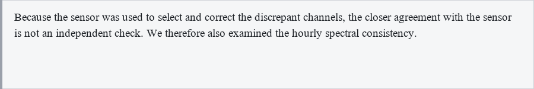

# dsh-translate-pin

[](#环境要求)
[](LICENSE)

**DSH 划词翻译 + 截图翻译：选中即译，框选屏幕任意区域 OCR 后把译文直接贴回原区域。**

Selection and screenshot translation for DeepSeek Harness (Windows): DeepSeek vision reads the captured screenshot and the Chinese translation replaces the original area in place, so the page looks like it was written in Chinese.

- **划词翻译**：在 DSH 里用鼠标选中外文，选区旁浮出「译」按钮，点一下就地出译文卡片。
- **截图翻译**：框选屏幕上任意区域后，直接把截图交给 **DeepSeek 读图翻译**，再把原文区域抹成该处底色、把译文画回原位置；**引用框/卡片的底色、边框、留白都会保留**，看起来就像这一段原文被直接替换。
- **桌面浮标 + 全局快捷键**：右下角常驻「译」浮标，`Ctrl+Shift+S` 全局可用；**DSH 最小化后仍然在桌面上**，不用先切回 DSH。
- **钉在桌面**：划词结果卡片可以「钉在桌面」，得到始终置顶、可拖动、可复制的对照小窗。
- **模型优先**：翻译/截图识别优先走 DSH 里已配置的 DeepSeek（支持图片输入的模型会直接读图）；模型不可用时才回退 Bing / Google / MyMemory + Windows OCR。




---

## 环境要求

| 依赖 | 说明 |
|---|---|
| Windows 10 / 11 | OCR 使用 `Windows.Media.Ocr`；置顶窗用 `tkinter` |
| DeepSeek Harness | 桌面端或 `dsh web` 均可（需要 Connection / WebServer 服务） |
| Python 3.10+（含 tkinter、Pillow） | DSH 桌面端自带 Python 运行时，带 tkinter 与 Pillow，无需另装 |
| Windows PowerShell 5.1 | 系统自带（`C:\Windows\System32\WindowsPowerShell\v1.0\powershell.exe`） |
| 中文 OCR 语言包 | Windows 设置 → 时间和语言 → 语言 → 中文(简体) 的“光学字符识别”可选功能；`en-US` 同理 |

插件启动时会自动在 `$DSH_HOME/dsh-runtimes/*/dependencies/python/pythonw.exe`、`C:\Python3xx\pythonw.exe` 中寻找 Python，也可以用环境变量 `DSH_TRANSLATE_PYTHON` 指定。

---

## 安装

### 方式一：从 GitHub 安装（推荐）

在 DSH 的「插件」页选择「从 GitHub 安装」，填：

```
github:zhaopw5/dsh-translate-pin
```

或者在允许 `dsh plugin` 管理的 profile 里：

```sh
dsh plugin --profile <profile> add github:zhaopw5/dsh-translate-pin
```

bundle 的 `cordis.patch.yml` 会自动插入 `translate-pin` 这一行。

### 方式二：本地目录（开发调试）

```sh
dsh plugin --profile <profile> add <本目录>
```

### 方式三：手动写 profile patch（桌面端 profile 只能这样）

桌面端的 `desktop` profile 由 Electron 独占管理，`dsh plugin` 会拒绝操作。请优先在应用内「插件」页安装；若要手动加载，编辑：

```
%USERPROFILE%\.dsh\profiles\desktop\cordis.patch.yml
```

在末尾追加：

```yaml
- insert:
    - id: translate-pin
      name: 'file:///C:/Users/<你>/.dsh/plugins/dsh-translate-pin/lib/index.js'
```

> 路径必须是合法的 `file:///` URL（正斜杠），不能直接写 `C:\...`。手动写 patch 的插件不会出现在「插件」列表里；用前两种方式安装才会作为 bundle 显示。

### 装完需要重启一次客户端

客户端插件的模块清单是**启动时**注入页面的，热加载只对 host 行生效。完全退出 DeepSeek Harness 再打开即可。之后：

1. 打开任意会话，右下角应出现「截图翻译」小按钮；
2. 选中一段英文，选区旁应出现「译」；
3. 控制台无 `dsh-translate-pin` 报错。

---

## 使用

### 划词翻译

1. 在对话/文章里选中一段外文（输入框、`contenteditable` 里不会触发）；
2. 松手后选区下方浮出「译」，点击；
3. 卡片显示「源语言 → 简体中文」、译文、服务商；可**复制**、**查看原文**、**钉在桌面**。
4. 纯中文选区会自动跳过（避免无意义的 zh→zh 请求）。

快捷键：`Ctrl+Shift+T` 直接翻译当前选区。

### 截图翻译（像原文被直接替换）

1. 点击右下角「截图翻译」、桌面「译」浮标，或按 `Ctrl+Shift+S`（全局，DSH 最小化也能按）；
2. 屏幕变暗，从**鼠标按下的那一点**开始拖拽框选；
3. 松开后**不会立即翻译**：选区保持不动，右下角出现「✓ 翻译 / × 取消」；点 ✓ 才开始截图翻译，点 × 或 `Esc` 直接取消；想改范围就重新拖一次；
4. 确认后把截图交给 DeepSeek 读图翻译（Windows OCR 只用来取行框位置），然后生成一张**合成图**：把框内文字区域抹成该处底色，保留外圈边框/左侧竖线/留白，再用相近字号把译文画回原位置——看起来就像这一段原文被直接替换成了译文；
5. 静止时有 **3px 直角灰色渐变边框**（外 `#9aa0aa` → 内 `#d9dce2`，无圆角，画在框选区域外侧，不遮译文）；鼠标移上去才出现「📌 / 复制 / 原文 / ×」小工具条——工具条沿用译文框的底色、文字色和 1px 灰色描边，风格与译文框一致，显示在译文框**外**（优先上方，贴边时放下方），不会遮住译文，鼠标移开即隐藏（按钮已加大到 10~11pt，点起来更稳）；
6. 按住左键可以拖动译文框（光标是移动图标）；工具条里的 **📌 图钉**用来切换“是否始终置顶”（默认钉住，点一下取消，再点恢复）；双击切换「译文 / 原文」，右键有菜单，`Esc` 关闭。

> 译文优先缩小字号塞进原框；实在放不下才向下加高，保证不裁字。字号会按原英文的行高来定（大约 1.08 倍），让中文尽量覆盖原英文占的区域。背景按局部底色采样，深色/浅色页面、灰底引用块都能融进去。

> 如果选区紧贴原文边缘（OCR 行框离任一边不到 3px），会自动取消 6px 外边距、整块覆盖截图，避免原文字从边上漏出来；此时原截图的边框/左侧竖线会一起被译文覆盖，由外层灰色边框代替。

> 框选与截图坐标是 1:1 的物理像素，不会再出现“框比鼠标慢半拍/起点偏移”的问题。

### 桌面浮标与全局快捷键

- 启动 DSH 后，屏幕右侧会出现一个圆形「译 · 截图」浮标，**始终置顶**；单击开始框选，拖动可换位置（位置会记住）。
- 右键浮标：截图翻译 / 隐藏浮标 / 退出工具。
- `Ctrl+Shift+S` 是**系统级**快捷键，DSH 最小化、被其他窗口挡住时都能触发。
- 浮标与快捷键由 DSH 的宿主进程托管：DSH 最小化不受影响；**完全退出 DSH 后**它们也会退出（下次启动自动回来）。

### 钉在桌面（划词结果）

- 划词译文卡片的「钉在桌面」会生成一个始终置顶的对照小窗；
- 「复制译文」复制全文；选中部分文字后复制只复制选区；
- 「显示原文」展开 OCR/原文；`Esc` / `Ctrl+W` / × 关闭；「置顶」按钮可临时取消置顶。
- 钉住位置会选在**当前前台窗口所在的显示器**右侧；多屏时不会跑到另一块屏。

---

## 配置

bundle 安装后，在 profile patch 里按行 id 覆盖配置（不要重复 insert）：

```yaml
- id: translate-pin
  config:
    targetLanguage: zh-Hans   # 默认简体中文；可填 en / ja / zh-Hant ...
```

| 字段 | 默认 | 说明 |
|---|---|---|
| `targetLanguage` | `zh-Hans` | 目标语言码（DeepSeek 提示词与 Bing/Google 回退共用） |

改完 `targetLanguage` 后，已打开的页面需要刷新，host 行会随 HMR 重载。

---

## 实现结构

```
dsh-translate-pin/
├─ lib/
│  ├─ index.js       # Host 插件：精确 Fetch 路由、翻译、OCR、进程管理
│  ├─ client.js      # 浏览器插件：划词浮标、译文卡片、截图入口
│  ├─ pinwin.py      # 桌面工具：浮标、全局快捷键、框选、原地译文窗、置顶窗
│  └─ ocr-server.ps1 # Windows OCR 常驻进程（en-US / zh-Hans 双引擎）
├─ cordis.patch.yml  # bundle 补丁层
└─ package.json
```

- **通信**：客户端走 `POST /api/translate-pin/*` 精确 Fetch 路由，复用 DSH 的 `/api` Cookie 鉴权；桌面端由 `dsh-app://app` 协议转发到本机 Host，不额外开放端口。
- **桌面工具**：`pinwin.py` 子进程在 Host 启动时拉起并常驻，负责浮标、`RegisterHotKey` 全局快捷键、框选和原地译文窗；Host 与它用 stdin/stdout 逐行 JSON 通信。
- **截图链路**：浮标/快捷键 → 框选确认 → Host 读图翻译（DeepSeek）→ 回传 rect 与译文 → 原地窗盖在原区域。
- **翻译**：优先用 `ctx.llm` 调用 DSH 当前配置的 DeepSeek 模型（默认 `deepseek-flash`，支持图片输入），让模型直接读截图、并在翻译时纠正 OCR 错字；模型不可用才回退 Bing / Google / MyMemory。
- **OCR**：只用于获取原文的**行框位置**（布局用）；截图翻译的正文以模型读图结果为准，避免 Windows OCR 把小字/符号读错后带进译文。

---

## 排查

日志：`%USERPROFILE%\.dsh\translate-pin\host.log`

| 现象 | 排查 |
|---|---|
| 右下角没有「截图翻译」 | 没重启客户端；或插件没作为 bundle 启用（「插件」页里确认 dsh-translate-pin 是开启状态）；看控制台是否有 `dsh-translate-pin` 报错 |
| 点截图没反应 | 日志里找 `spawning pin helper` / `pin stderr`；确认 Python 有 tkinter + Pillow |
| OCR 报 `no Windows OCR engine available` | 安装中文(简体) OCR 语言包 |
| 翻译失败 | 日志 `rpc/translate`；Bing 需要能直连 `edge.microsoft.com`；公司代理环境可在 `$DSH_HOME/.dsh-translate.json` 之外自行配置系统代理 |
| 钉住窗口没出现 | 可能被前台窗口挡在另一块屏；日志 `selftest pin`；`Get-Process pythonw` 是否存活 |
| 装完客户端起不来（Failed to load plugins） | 删掉 profile patch 里的 `translate-pin` 块，重启；把日志发我 |

---

## 已知限制

- **只支持 Windows**：OCR 依赖 `Windows.Media.Ocr`，浮标/全局快捷键依赖 Win32。
- **DSH 完全退出后桌面浮标也会退出**：它是 DSH 宿主进程的子进程；最小化、切到别的窗口都不影响。若需要 DSH 关掉也常驻，可以把 `pinwin.py` 配成开机启动的独立进程（目前未提供）。
- **OCR 只负责定位行框**：正文由 DeepSeek 读图翻译；模型不可用时才回退 Windows OCR 文本，精度会明显下降。
- **划词只在 DSH 页面内生效**：它监听的是页面选区，不是系统级全局划词；系统级入口是截图翻译（浮标 / `Ctrl+Shift+S`）。
- **原地译文窗会盖住原截图区域**：这是设计目标；需要对照原文时点窗内「原文」。
- **桌面端必须重启一次**：客户端的模块清单在启动时注入，热加载只覆盖 host 行。
- 若 `Ctrl+Shift+S` 被其他软件占用，日志里会有 `RegisterHotKey ... failed`，此时用浮标或页面右下角按钮即可。

## 卸载

1. 在 DSH「插件」页卸载 `dsh-translate-pin`（或 `dsh plugin --profile <profile> remove dsh-translate-pin`）；
2. 重启客户端；
3. 可选：删除本目录与 `%USERPROFILE%\.dsh\translate-pin` 日志目录。

## License

MIT


